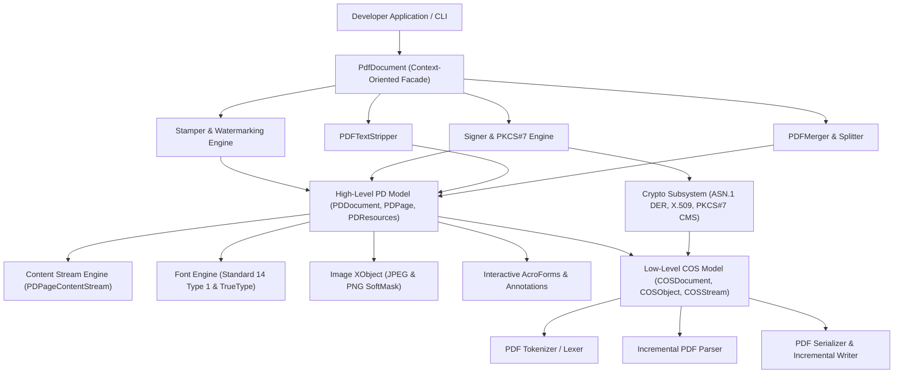

# Architecture of rust-pdf-box

`rust-pdf-box` is an idiomatic, pure Rust implementation of Apache PDFBox engineered for safety, performance, context-oriented ergonomics, and ISO 32000 conformance.

---

## 1. High-Level System Architecture

The codebase is structured into clear, decoupled layers:

---

## 2. Layer Descriptions

### 2.1 The COS Model (`src/cos/`)
The **COS (Certificate / Content Object Stream)** layer is the foundation of PDF:
- **`COSObject`**: The fundamental enum representing PDF primitives:
  - `Null`, `Boolean`, `Integer`, `Real`, `String`, `Name`, `Array`, `Dictionary`, `Stream`, `Reference`.
- **`COSDocument`**: In-memory representation of the PDF object table, dirty-object tracking set, and trailer dictionary.
- **`Lexer`**: Fast, zero-allocation scanner handling PDF comments, literal strings with escape codes and octal numbers, hex strings, names with `#XX` escapes, and binary stream payloads.
- **`Parser`**: Capable of reading backwards to locate `startxref`, traversing multi-revision classic XRef tables and modern compressed XRef streams (`/Type /XRef`), and expanding object streams (`/Type /ObjStm`).
- **`Writer`**: Serializes COS structures with optional Deflate compression, builds sorted indirect object tables, formats 10-digit XRef entries, and supports **incremental updates** (`save_incremental`) to append revisions without touching previous byte ranges.

### 2.2 The PD Model (`src/pd/`)
The **PD (Page Description)** layer models the visual document hierarchy:
- **`PDDocument`**: Root container providing high-level page lifecycle methods (`add_page`, `insert_page`, `remove_page`, `page_count`).
- **`PDPage`**: Represents individual pages with MediaBox, CropBox, Rotation (0°, 90°, 180°, 270°), resource dictionaries, and content stream lists.
- **`PDRectangle`**: Standard coordinate geometry with standard sizes (`A4`, `A3`, `LETTER`, `LEGAL`, etc.).
- **`PDResources`**: Manages fonts, XObjects, and Extended Graphics States (`/ExtGState`).

### 2.3 The Content Stream Engine (`src/content/`)
- **`PDPageContentStream`**: Emits PDF graphics operators with three append modes:
  - `AppendMode::Overwrite`: Replaces page content entirely.
  - `AppendMode::Append`: Appends graphics after existing content (foreground stamps).
  - `AppendMode::Prepend`: Prepends graphics before existing content (background watermarks).
- **Graphics State Operators**: `q` (save), `Q` (restore), `w` (line width), `J` (cap), `j` (join), `cm` (transform matrix), `re` (rect), `m` / `l` / `c` (path construction), `s` / `f` / `B` (painting), and `W n` (clipping).
- **Color Systems**: RGB, CMYK, Grayscale, and Hex conversion.
- **Transparency**: Automatic `/ExtGState` registration for fill and stroke alpha opacity.

### 2.4 Cryptography & Digital Signatures (`src/crypto/` & `src/sign/`)
- **ASN.1 DER Engine**: Pure-Rust encoder for Sequences, Sets, OIDs, OctetStrings, UTCTime, GeneralizedTime, and Context-Specific tagged elements.
- **X.509 Generator**: Enables 1-line generation of RSA key pairs and self-signed X.509 v3 certificates in pure Rust with zero OpenSSL dependencies.
- **Detached PKCS#7 / CMS**: Builds standard Adobe-compatible `SignedData` structures containing signed attributes (`contentType`, `messageDigest`, `signingTime`) signed by RSA-SHA256.
- **ByteRange Integrity**: Reserves pre-allocated `/Contents <...>` byte gaps, computes SHA-256 over exact document byte ranges, and verifies signatures with tamper detection.

### 2.5 Stamping & Watermarking (`src/stamp/`)
- Context-oriented builder supporting text watermarks, rubber stamps, running headers/footers with dynamic `{page}` and `{total}` substitutions, and image stamps.

### 2.6 Interactive AcroForms & Flattening (`src/interactive/`)
- Discovers form fields (`Tx`, `Btn`, `Ch`, `Sig`), modifies values, and flattens forms (`flatten`) by burning widget appearance streams into page content streams and removing interactive widget dictionaries.

### 2.7 Text Extraction (`src/text/`)
- `PDFTextStripper` parses `BT ... ET`, `Tj`, `TJ`, `'`, `"`, `Td`, and `Tm` operators, reconstructing readable text and line breaks.
